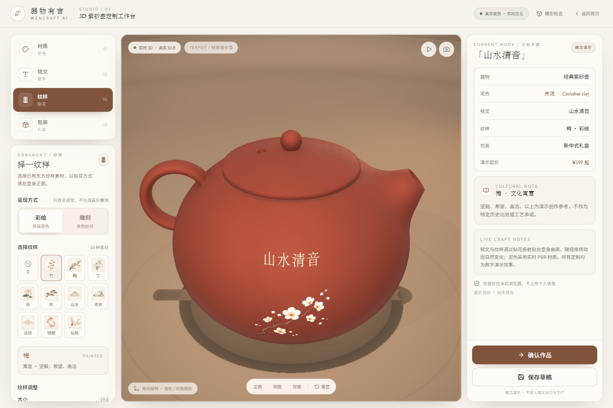
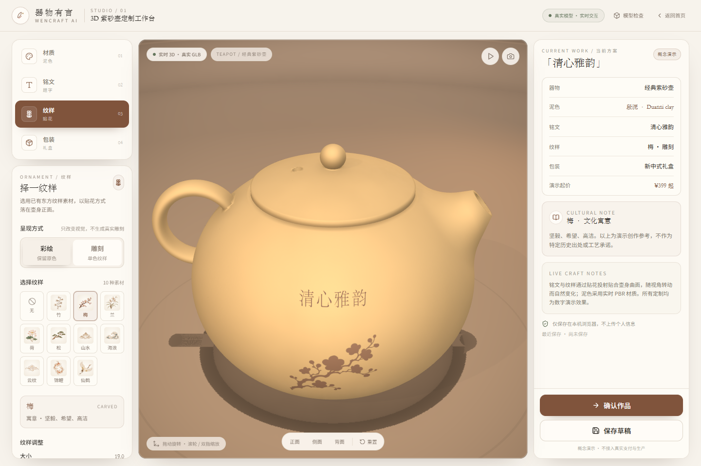
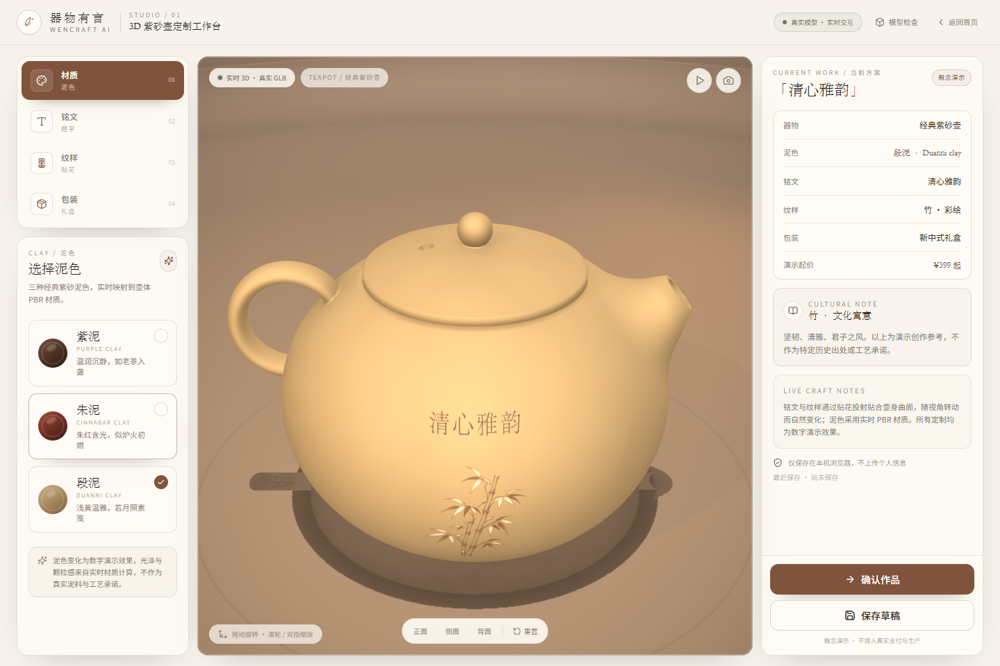
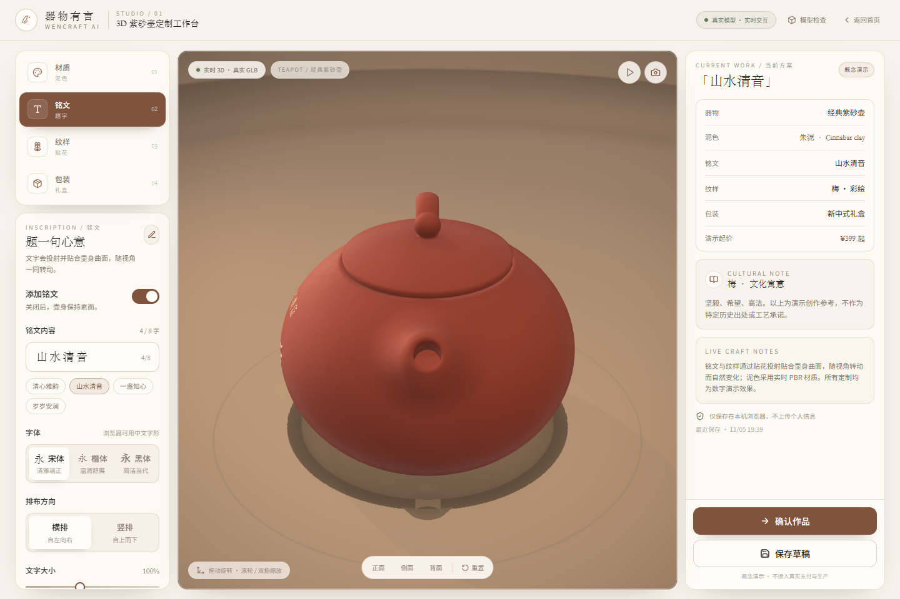
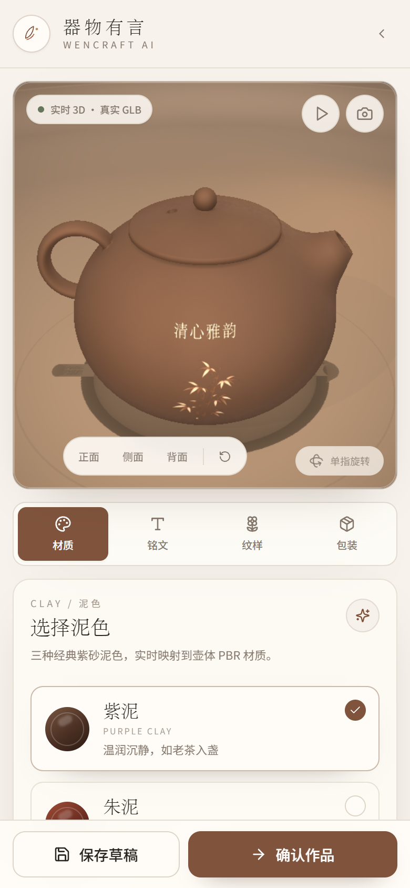
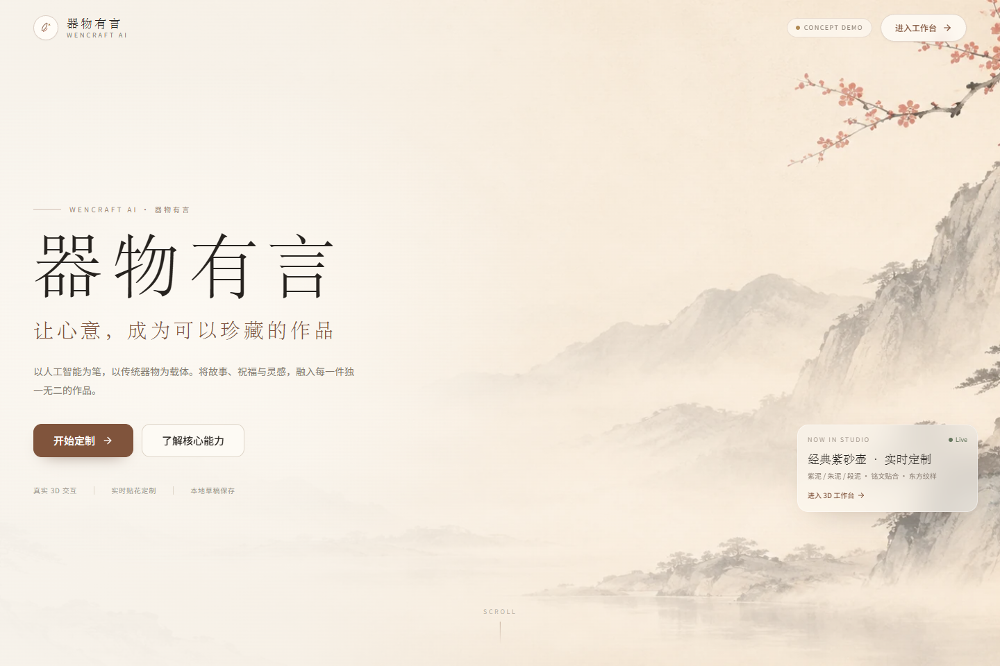

# 器物有言 · WenCraft AI

> 让心意，成为可以珍藏的作品。

当前仓库完成的是**第一阶段核心成果：3D 紫砂壶定制工作台**。重点是把真实 GLB、实时材质、贴合壶身的铭文和纹样切换做通，并经过浏览器实测。

> 概念演示项目。不接入真实支付、生产、物流或用户账号。当前阶段没有 AI 后端、问卷、明信片、数字档案、Docker 部署，这些属于后续阶段。

## 预览

| 3D 工作台 · 30° 俯视 + 朱泥 + 梅纹 | 3D 工作台 · 雕刻纹样特写 |
| --- | --- |
|  |  |

| 段泥 + 深色铭文 | 侧视角 · 贴花固定在壶身正面 |
| --- | --- |
|  |  |

| 移动端工作台 | 首页 |
| --- | --- |
|  |  |

模型检查页：`/model-inspector`，截图见 `docs/preview/model-inspector.png`。

## 快速开始

环境要求：Node.js 20+（本项目在 Node 24 下验证）、npm 10+。

```bash
cd wencraft-ai
npm install
npm run dev
```

打开（路由使用 HashRouter，便于静态托管）：

- 首页（默认）：http://localhost:5173/
- 3D 工作台：http://localhost:5173/#/studio
- 模型检查：http://localhost:5173/#/model-inspector

根路径不自动跳转工作台；打开 `http://localhost:5173/` 会先进入首页。

构建与检查：

```bash
npm run typecheck
npm run build
npm run preview
```

浏览器冒烟检查（需要先启动 `npm run dev`）：

```bash
npm run smoke
```

脚本默认寻找本机 Edge/Chrome。找不到时设置 `PW_EXECUTABLE`：

```powershell
$env:PW_EXECUTABLE = 'C:\Program Files\Google\Chrome\Application\chrome.exe'
npm run smoke
```

可通过 `BASE_URL` 指定其他地址（smoke 已适配 `#/` 路由），截图输出到 `test-output/`。

## 部署到 GitHub Pages

GitHub Pages 的发布单位是**代码仓库**，不是 GitHub Projects 项目面板。请使用仓库地址（例如 `https://github.com/<用户名>/<仓库名>`）来部署。

这个项目已经按纯静态站点适配，可以直接放到 GitHub Pages 项目子路径：

- Vite 生产构建使用相对 `base: './'`。
- 路由改用 `HashRouter`，分享链接形如 `...#/studio`，不依赖服务器 SPA 回退。
- 模型、纹样、背景图通过 `assetUrl()` 基于 `BASE_URL` 生成，不会写死站点根路径。
- `.nojekyll` 已加入 `public/`，避免 GitHub Pages 的 Jekyll 干扰静态资源。
- Actions 工作流：`.github/workflows/deploy-pages.yml`。

### 1. 推送到 GitHub

当前目录还不是 git 仓库。先在 GitHub 新建一个仓库（建议 public），然后执行：

```bash
git init
git add .
git commit -m "feat: WenCraft AI 3D studio demo"
git branch -M main
git remote add origin https://github.com/<你的用户名>/<仓库名>.git
git push -u origin main
```

### 2. 开启 GitHub Pages

进入仓库 **Settings → Pages → Build and deployment**，把 **Source** 设为 **GitHub Actions**。

之后每次推送到 `main`，或手动运行 **Actions → Deploy to GitHub Pages**，都会自动构建并发布 `apps/web/dist`。

### 3. 分享链接

部署完成后，在 **Actions** 的部署记录或 **Settings → Pages** 中看到地址，通常为：

```text
https://<用户名>.github.io/<仓库名>/          # 首页（默认）
https://<用户名>.github.io/<仓库名>/#/studio  # 3D 工作台
```

如果仓库名是 `<用户名>.github.io`（用户主页仓库），首页就在域名根路径：

```text
https://<用户名>.github.io/          # 首页
https://<用户名>.github.io/#/studio  # 3D 工作台
```

### 注意事项

- 建议仓库设为 **public**。私有仓库使用 GitHub Pages 通常需要 GitHub Pro/Team。
- GitHub Pages 只能托管静态前端。当前 3D 定制、草稿保存、截图下载可以正常分享；后续 AI API、公开数字档案、SQLite、二维码等需要单独的 API 服务。
- 草稿保存在访问者自己的浏览器 `localStorage` 中，不会跨设备同步。
- 如需自定义域名，在 **Settings → Pages → Custom domain** 配置；相对资源路径仍然适用。
- 首次部署如果 Actions 报 Pages 未启用，请先完成第 2 步，再重新运行工作流。

## 本阶段已实现

### 3D 紫砂壶工作台

- 加载真实 `teapot.glb`，不是静态图片替代。
- 默认 30° 俯视构图，打开即可看到壶盖、壶身和台面层次；主光从左前方斜射，环境保持较暗。
- 鼠标/单指拖动旋转，滚轮/双指缩放。
- 自动旋转开关、重置视角、正面/侧面/背面快捷视角。
- 四灯柔光棚 + 室内环境反射 + 实时投影 / 接触阴影 + 无缝陶色棚拍背景。
- 导出当前 3D 预览 PNG。
- 响应式桌面/移动端布局。

### 材质切换

- 紫泥、朱泥、段泥三种泥色。
- 使用 `MeshPhysicalMaterial` 实时更新颜色、粗糙度、sheen 和反射。
- 切换泥色时，若铭文仍使用自动对比色，会自动在浅金与深褐之间调整，保证可读性。
- 材质更换复用同一个已编译着色器，避免切换时重新编译造成卡顿。

### 视觉渲染升级

- **程序化陶土颗粒**：生成 256px 可平铺 fBm 噪声 DataTexture，在 `MeshPhysicalMaterial.onBeforeCompile` 中做三向采样，同时影响颜色、粗糙度和法线扰动；不需要模型 UV。
- **柔光棚照明**：四盏 `RectAreaLight`（主光、补光、轮廓光、顶光）+ 带阴影的平行主光 + 环境半球光；开启 ACES 色调映射。
- **斜向主光与暗环境**：主光从左前方斜射，右侧轮廓光勾边；背景、地板和远景压暗，仅在壶体与台面保留光池。
- **无缝棚拍背景**：`LatheGeometry` 生成地面到弧形墙面的连续陶色背景，使用顶点色控制地面 / 墙面过渡，取消硬地平线。
- **阴影与 AO**：静态烘焙的平行光阴影贴图、`ContactShadows` 接触阴影、N8AO 环境光遮蔽、轻量 Bloom 与 Vignette。
- **性能取舍**：阴影贴图只更新一次；N8AO 使用 half-res；移动端自动降低 DPR 和 AO 质量；程序化颗粒片元着色器随环境光一起工作。

### 铭文贴花

- 默认铭文「清心雅韵」，最多 8 个汉字。
- 宋体/楷体/黑体三种浏览器字体栈。
- 自定义颜色、文字大小、横排/竖排。
- 使用 `CanvasTexture + DecalGeometry` 投射到壶身曲面，不是屏幕悬浮 HTML。
- 文字随视角转动贴合壶面；背视角不会出现背面重复贴花。

### 纹样贴花

- 竹、梅、兰、荷、松、山水、海浪、云纹、锦鲤、仙鹤 10 种已有素材。
- 彩绘/雕刻两种显示方式；雕刻用单色 alpha 蒙版模拟。
- 大小、左右位置、上下位置、旋转可调。
- 位置范围限制在壶身正面，避开壶嘴、壶把和壶盖。

### 其它

- 包装演示选择：经典纸盒、新中式礼盒、布袋包装。
- 草稿自动持久化到 `localStorage`，刷新可恢复；「保存草稿」提供明确反馈。
- 演示确认单：生成模拟订单编号、保存方案快照到本机，明确提示不产生真实订单/支付。
- 模型检查页展示网格、顶点、三角面、UV、法线、包围盒和壶盖合拢记录。

## 素材检查结果

素材来源：`C:\Users\xyc\Pictures\ai文创`。原始文件保留，不覆盖。

### 图片

| 素材 | 尺寸 | 色彩模式 | Alpha | 用途 |
| --- | --- | --- | --- | --- |
| 背景图.png | 1672×941 | RGB | 无（不透明） | 首页全宽背景 |
| 紫砂壶.png | 1122×1402 | RGB | 无（不透明） | 产品卡片/封面 |
| 明信片.png | 1122×1402 | RGB | 无（不透明） | 产品卡片/封面 |
| 竹、梅、兰、荷、松、山水、海浪、云纹、锦鲤、仙鹤 | 均为 1254×1254 | RGBA | 有真实透明通道 | 纹样贴花 |

- 10 张纹样均检测到 alpha 通道，透明区域约占 72%–96%，不是黑色假透明背景。
- 首页背景和两张产品摄影为不透明 RGB，已按要求作为照片使用，不强行当透明贴花。
- 纹样原始 PNG 复制到 `public/assets/ornaments/`。
- 生成 320px WebP 缩略图到 `ornaments/thumbs/`，1024px WebP 贴花版本到 `ornaments/textures/`。
- 产品封面和背景同时保留 PNG，并生成 WebP 优化版本。

### GLB 检查

原始 `茶壶.glb`：

- 1 个 mesh，44,468 个顶点，88,940 个三角面。
- 只有 `POSITION` 和索引，**没有 UV、没有材质、没有纹理**。
- 包围盒：`[-32.69, -29.99, -18.0] → [37.37, 29.99, 40.56]`，Z-up。
- 网格由两个不连通壳体组成：壶身（含壶嘴/壶把）和壶盖。
- 壶盖底部圆环半径 16.3332，壶身壶口圆环半径 16.5831，壶盖原始位置悬在壶口上方约 10.75 单位。

### 壶盖合拢处理

使用 `tools/process-teapot.py` 可复现：

1. 以 `z > 25` 识别壶盖顶点。
2. 壶盖 XY 径向缩放 `16.5831 / 16.3332 = 1.0153`，与壶口匹配。
3. 壶盖沿 Z 下移 `10.99757`，并在壶口内沿保留 `0.25` 的重叠量，避免悬空缝隙。
4. 烘焙旋转：X 轴 -90°（转为 Y-up），Y 轴 180°（壶嘴朝 -X、壶把朝 +X，与产品封面一致）。
5. 整体上移 18 单位，使壶底落在 `y = 0`。
6. 重新计算并导出朝外法线，输出 `apps/web/public/assets/models/teapot.glb`。
7. 处理结果记录在 `teapot-meta.json`，模型检查页会读取展示。

处理后可水密检查为两个封闭壳体，壶盖底部落在壶口内沿，从正面、侧面、背面均无悬空或穿插。

复现命令：

```bash
pip install trimesh numpy
python tools/process-teapot.py --source "C:\Users\xyc\Pictures\ai文创\茶壶.glb"
```

## 没有 UV 时如何做贴花

因为原始 GLB 没有 UV，不能直接使用 UV 贴图。当前采用：

- 从壶身正面（+Z）向壶体投射 `DecalGeometry`。
- 投射盒深度限制在壶身外壁，避免把图案投到背面。
- 透明贴图使用 `alphaTest`，材质深度测试保留，`polygonOffset` 防止与壶面 z-fighting。
- 只启用正面，隐藏壶内壁/背面的投射结果。
- 铭文与纹样在同一个世界坐标空间中，和器物一起随视角变化。

## 项目结构

```text
wencraft-ai/
├── .github/workflows/deploy-pages.yml
├── apps/
│   └── web/
│       ├── public/
│       │   ├── .nojekyll
│       │   └── assets/
│       │       ├── backgrounds/
│       │       ├── products/
│       │       ├── ornaments/{thumbs,textures}/
│       │       └── models/{teapot.glb,teapot-meta.json}
│       └── src/
│           ├── components/
│           ├── data/
│           ├── features/studio3d/
│           ├── lib/
│           ├── pages/
│           ├── store/
│           ├── styles/
│           └── types/
├── docs/preview/
├── scripts/smoke.mjs
├── tools/process-teapot.py
├── package.json
└── README.md
```

技术栈：React 18、TypeScript、Vite、Tailwind CSS、React Router、Zustand、Framer Motion、Three.js、React Three Fiber、Drei、@react-three/postprocessing、N8AO、Lucide React。

## 验证结果

在 Windows + Edge headless（SwiftShader WebGL）下实测：

- `npm run typecheck`：通过。
- `npm run build`：通过。
- `npm run smoke`：通过，无页面异常、无控制台错误。
- `npm run build` 后使用 `vite preview` 生产构建复测，核心流程同样通过。
- 把 `apps/web/dist` 放到 `/repo/` 子路径的静态服务器，模拟 GitHub Pages 项目站点；`BASE_URL=http://127.0.0.1:5000/repo npm run smoke` 通过，确认相对资源和 `#/studio` 路由正常。
- `npm audit --omit=dev`：0 个生产依赖漏洞。
- 真实 GLB 可加载、旋转、缩放，切换正面/侧面/背面。
- 三种泥色实时变化；紫泥、朱泥、段泥均已截图验证。
- 3D 视觉：程序化陶土颗粒、四灯柔光棚、斜向主光与暗环境、无缝棚拍背景、投影 / 接触阴影、N8AO、Bloom、Vignette 均已验证。
- 默认打开为 30° 俯视视角；重置视角回到该构图。
- 铭文「清心雅韵」「山水清音」可输入、修改颜色/字体/大小/方向，贴花随壶面转动。
- 梅、荷等纹样切换实时生效；彩绘 / 雕刻均验证。
- 材质切换后左侧选中态与右侧方案信息同步，不出现状态错位。
- 草稿保存后刷新可恢复铭文和材质状态。
- 截图下载成功，文件名为 `器物有言-紫砂壶-日期.png`。
- 390px 移动端无横向溢出，3D 场景、Tab 编辑区和固定操作栏均可使用。
- 首页、模型检查页正常渲染。

## 当前限制与下一阶段

本阶段**未实现**：

- AI 服务代理、真实/模拟 AI 方案、三套候选方案。
- 引导式问卷、方案选择工作台同步。
- 国风明信片 2D 编辑器。
- 公开数字档案、SQLite、二维码、后端限流。
- 模拟订单状态流、我的作品页。
- Docker Compose、Caddy、HTTPS、Linux 部署。

当前所有定制状态只保存在本机 `localStorage`，没有后端和账号系统。下一阶段可按原计划继续接入 `apps/api`（Fastify + Zod + SQLite）、AI 创作流程和部署配置。

## 说明

- 价格、订单、包装、泥色、纹样效果均为概念演示，不代表真实工艺或生产承诺。
- 页面使用系统中文宋体/楷体/黑体字体栈，不打包未授权字体；不同操作系统实际字形可能略有差异。
- 用户提供的图片和 GLB 仅作为本项目演示素材使用。
